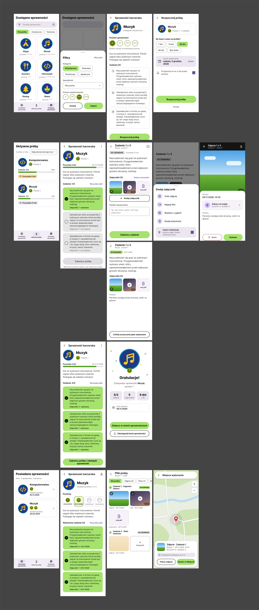

## Opis
Aplikacja ma na celu ułatwić śledzenie zdobytych sprawności oraz wykonanych zadań do prób na sprawności.

Użytkownik może przeglądać listę dostępnych sprawności. Wybierając sprawność może zobaczyć na czym ta sprawność polega, jakie ma poziomy oraz jakie zadania trzeba wykonać w próbie.

Następnie może rozpocząć próbę i ustalić ile czasu ma na jej ukończenie. Rozpoczęte próby można przeglądać na osobnej liście, gdzie będzie wyświetlał się ich stan, liczba ukończonych/rozpoczętych zadań oraz pozostały czas. Po wejściu w otwartą próbę może zobaczyć listę zadań, jakie są ukończone, jakie nie, oraz jeśli ukończy wszystkie zadania to może zakońćzyć próbę. W próbie, po wejściu w zadanie może dodać notatkę i załączniki potwierdzające wykonanie tego zadania. Do załączników moża dołączyć aktualną loalizację, co może potwierdzić np. Miejsce wykonania zdjęcia lub nagrania. Po ukończeniu próby użytkownik zdobywa sprawność.

Zdobyte sprawności znajdują się na osobnej liście, gdzie można zobaczyć jakie poziomy zostały zrobione i daty kiedy zostały zrobione. W szczegółach sprawności można przeglądać wykonane zadania i załączniki do nich.

## Funkcjonalności
- Przeglądanie dostępnych sprawności
- Sprawdzenie szczegółów sprawności
- Rozpoczęcie próby
- Przeglądanie rozpoczętych prób
- Zakończenie próby
- Zaliczenie zadania w próbie
- Dodanie załącznika do zadania
- dodanie lokalizacji do załącznika
- Przeglądanie zdobytych sprawności
- Zobaczenie załączników dodanych do zadań w trakcie próby na sprawność

## Mockup

